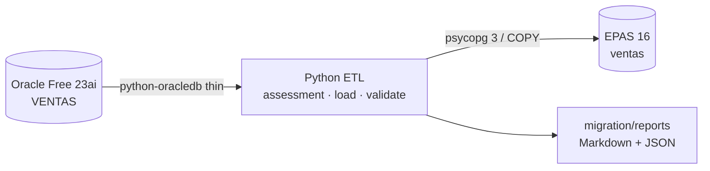

# Laboratorio de migración Oracle → EDB Postgres Advanced Server

[](https://github.com/TU_USUARIO/edb-oracle-migration-lab/actions/workflows/ci.yml)
[](LICENSE)
[](https://www.python.org/)
[](https://www.enterprisedb.com/docs/epas/latest/)

Un laboratorio completo, reproducible y documentado en español para migrar
una base de datos Oracle a **EDB Postgres Advanced Server (EPAS)**. No es una
tabla de ejemplo: incluye tipos de datos difíciles, LOBs, XML, JSON, RAW,
objetos, colecciones anidadas, secuencias, identidades, índices, vistas,
vistas materializadas, paquetes PL/SQL, procedimientos, funciones, triggers,
auditoría y validación automática.

> **Estado**: proyecto educativo listo para publicar en GitHub. La ejecución
> end-to-end requiere Docker, acceso a una imagen de EPAS (comercial) y los
> pasos del [runbook](docs/13-runbook.md). El CI valida lint, compilación
> Python, sintaxis Bash y configuración de Compose sin levantar bases.

## ¿Por qué este laboratorio?

La promesa de EDB es migrar Oracle de forma rápida y con mínimos cambios. Ese
mensaje se entiende mejor cuando se prueba con objetos reales:

- ¿Qué pasa con un `DATE` Oracle que guarda hora?
- ¿Cómo se migra una `NESTED TABLE`?
- ¿Un paquete con `PRAGMA AUTONOMOUS_TRANSACTION` sigue funcionando?
- ¿Qué pasa con un índice bitmap?
- ¿Cómo se valida que los datos llegaron completos?
- ¿Cómo se evita duplicar la auditoría durante la carga?

Este repositorio responde esas preguntas con código ejecutable y decisiones
documentadas.

## Qué incluye

| Área | Detalle |
|---|---|
| Origen | Oracle Database Free 23ai, PDB `FREEPDB1`, esquema `VENTAS` |
| Destino | EDB Postgres Advanced Server 16, base/esquema `ventas` |
| Modelo | 12 tablas, 60 clientes, 40 productos, 300 pedidos, ~1.500 filas |
| Tipos | `NUMBER`, `VARCHAR2`, `CHAR`, `DATE`, `TIMESTAMP [WITH [LOCAL] TIME ZONE]`, `INTERVAL`, `CLOB`, `BLOB`, `RAW`, `XMLTYPE`, JSON en CLOB, `BINARY_FLOAT`, identidad, virtuales |
| Objetos | 2 UDT, 5 secuencias, 3 identidades, 20 índices, 6 vistas, 1 MV, 4 paquetes, 3 objetos sueltos, 7 triggers |
| Datos | ETL Python con `python-oracledb` thin + `psycopg` 3 + `COPY` |
| Validación | Conteos, nulos, checksums SHA-256 canónicos y 18 pruebas funcionales |
| Performance | Benchmark indicativo + guía de índices y planes |
| Docker | Oracle Free + EPAS, healthchecks, volúmenes y entrypoint propio |
| Herramientas EDB | Migration Portal, MTK, LiveCompare, EDB*Loader, AI Copilot y guía de CDC |
| Docs | 23 documentos en español, runbook, troubleshooting y checklist de cutover |

## Arquitectura



## Inicio rápido

### 1. Requisitos

- Docker Engine/Desktop 24+ con Compose v2.
- Python 3.11+ (en Debian/Ubuntu: `sudo apt install python3-venv`).
- 8 GB de RAM y 20 GB de disco libres (16 GB recomendados).
- Acceso a una imagen de EPAS. El registro de EDB requiere cuenta y token.
- Oracle Database Free se descarga sin credenciales.

### 2. Clonar y configurar

```bash
git clone <URL_DEL_REPOSITORIO> edb-oracle-migration-lab
cd edb-oracle-migration-lab

cp .env.example .env
# Edita .env: contraseñas, EDB_IMAGE y puertos.

make venv
make check
```

### 3. Autenticarse en EDB

```bash
export EDB_TOKEN='...'
docker login docker.enterprisedb.com --username k8s --password-stdin <<< "$EDB_TOKEN"
```

Si tu organización usa otro registry, cambia `EDB_IMAGE` en `.env`.

### 4. Levantar las bases

```bash
make up
```

Espera a que `lab-oracle` y `lab-edb` estén `healthy`. La primera vez tarda
varios minutos.

### 5. Ejecutar el laboratorio

```bash
make oracle-load     # esquema + datos en Oracle
make assess          # inventario y riesgos
make edb-schema      # tablas destino
make migrate         # ETL Oracle -> EPAS
make post-load       # índices, FKs, vistas, MV, PL/SQL, triggers
make validate        # conteos, checksums y pruebas funcionales
make benchmark       # tiempos indicativos
```

O el flujo completo:

```bash
make all
make validate
```

### 6. Herramientas EDB (opcional)

Si tienes las herramientas comerciales instaladas:

```bash
make tools-check        # qué hay disponible
make portal-export      # DDL para Migration Portal
make mtk-schema         # DDL offline con MTK
make edbldr-demo        # carga con EDB*Loader
make livecompare-grant  # comparación con LiveCompare
```

Ver [docs/18-herramientas-edb.md](docs/18-herramientas-edb.md).

### 7. Ver resultados

- `migration/reports/assessment.md`
- `migration/reports/data_load.json`
- `migration/reports/validation.md`
- `migration/reports/validation.json`
- `migration/reports/benchmark.md`

## Comandos principales

| Comando | Qué hace |
|---|---|
| `make help` | Lista todos los objetivos |
| `make check` | Verifica Docker, Python y configuración |
| `make up` / `make down` | Levanta / detiene los contenedores |
| `make oracle-load` | Crea y carga el esquema Oracle |
| `make assess` | Analiza el esquema Oracle |
| `make edb-schema` | Crea tablas y secuencias en EPAS |
| `make migrate` | Carga datos con COPY |
| `make post-load` | Crea índices, FKs, vistas, MV, paquetes y triggers |
| `make validate` | Compara datos y ejecuta pruebas funcionales |
| `make benchmark` | Compara tiempos Oracle vs EPAS |
| `make portal-export` | Exporta DDL para EDB Migration Portal |
| `make mtk-schema` / `make mtk-data` | Genera artefactos con EDB Migration Toolkit |
| `make edbldr-demo` | Carga un archivo con EDB*Loader |
| `make livecompare` | Compara Oracle vs EPAS con LiveCompare |
| `make tools-check` | Comprueba las herramientas EDB instaladas |
| `make reset` | Reconstruye todo desde cero (borra volúmenes) |
| `make test` | Pruebas unitarias sin base de datos |
| `make lint` | Ruff, compilación Python y sintaxis Bash |

## Estructura del repositorio

```text
.
├── .github/                 # CI, plantillas de issues y PR
├── docker/
│   ├── compose.yaml         # Oracle + EPAS
│   ├── oracle/init/         # Grants del usuario de aplicación
│   └── edb/                 # Dockerfile + entrypoint standalone
├── sql/
│   ├── oracle/              # DDL, PL/SQL, triggers y semilla
│   └── edb/                 # Esquema destino y objetos migrados
├── migration/
│   ├── config/              # Manifiesto, pruebas funcionales, benchmark
│   ├── etl/                 # Assessment, ETL, validación, benchmark
│   ├── edb-tools/           # Portal, MTK, LiveCompare, EDB*Loader, CDC
│   ├── ora2pg/              # Configuración complementaria
│   └── reports/             # Salidas generadas (gitignored)
├── scripts/                 # Orquestación Bash + Makefile
├── docs/                    # Documentación completa en español
├── tests/                   # Pruebas unitarias de lógica pura
├── .env.example
├── Makefile
├── pyproject.toml
└── README.md
```

## Documentación

Empieza por el [índice de documentación](docs/README.md). Los documentos clave:

- [Introducción](docs/00-introduccion.md)
- [Arquitectura](docs/01-arquitectura.md)
- [Requisitos](docs/02-requisitos.md)
- [Habilitar Oracle y EDB en Docker](docs/03-docker-oracle-edb.md) ← **guía de Docker**
- [Modelo de datos](docs/04-modelo-datos.md)
- [Mapeo de tipos Oracle → EPAS](docs/05-mapeo-tipos-datos.md)
- [Migración de esquema](docs/06-migracion-esquema.md)
- [Migración de datos](docs/07-migracion-datos.md)
- [PL/SQL a EPAS](docs/08-plsql-a-epas.md)
- [Índices y rendimiento](docs/09-indices-rendimiento.md)
- [Vistas y materializadas](docs/10-vistas-mv.md)
- [Triggers y secuencias](docs/11-triggers-secuencias.md)
- [Validación](docs/12-validacion.md)
- [Runbook](docs/13-runbook.md)
- [Troubleshooting](docs/14-troubleshooting.md)
- [Post-migración](docs/15-post-migracion.md)
- [Ora2Pg](docs/16-ora2pg.md)
- [Referencias](docs/17-referencias.md)
- [Herramientas EDB](docs/18-herramientas-edb.md)
- [Migration Toolkit](docs/19-mtk.md)
- [Migration Portal y AI Copilot](docs/20-migration-portal.md)
- [LiveCompare](docs/21-livecompare.md)
- [Replication Server](docs/22-replication-server.md)

## Qué demuestra la migración

- **Tipos**: `NUMBER` → `numeric`/`bigint`, `DATE` → `timestamp(0)`, `CLOB` →
  `text`, `BLOB`/`RAW` → `bytea`, `XMLTYPE` → `xml`, JSON → `jsonb`, objeto →
  columnas planas, nested table → `text[]`.
- **Datos**: `COPY` con normalización explícita, LOBs, XML, JSON, arreglos,
  timestamps con zona horaria y secuencias.
- **PL/SQL**: paquetes, `%TYPE`, cursores, excepciones, `MERGE`,
  `AUTONOMOUS_TRANSACTION`, `DBMS_OUTPUT`, SQL dinámico.
- **Índices**: funcionales, parciales, covering, GIN; bitmap/IOT como brechas
  documentadas.
- **Vistas/MV**: `CONNECT BY`, `ROWNUM`→`LIMIT`, refresco completo vs fast.
- **Triggers/secuencias**: auditoría, historial de precios, identidades y
  resync.
- **Validación**: checksums canónicos y pruebas funcionales Oracle vs EPAS.
- **Herramientas EDB**: exportación para Migration Portal, wrapper de MTK,
  comparación con LiveCompare, carga con EDB*Loader y guía de CDC.

## Resultados esperados

Los reportes se generan en `migration/reports/`. Un resultado sano se ve así:

```text
Validando 12 tablas...
  regiones                OK
  paises                  OK
  clientes                OK
  ...
Pruebas funcionales: 18/18 OK
Resultado global: OK
```

Los números exactos de filas dependen de la semilla y de los triggers.

## Limitaciones y advertencias

- **EPAS es comercial.** La imagen de contenedor requiere acceso al registro
  de EDB y una licencia/evaluación válida. No hay imagen oficial gratuita en
  Docker Hub. Si la imagen exige una license key del operador, el entrypoint
  standalone no la inyecta.
- El contenedor EPAS es un entorno de laboratorio de un solo nodo, sin TLS,
  backups ni HA. No lo uses en producción.
- El benchmark es indicativo; no compara hardware ni cargas reales.
- La validación carga las tablas en memoria; para volúmenes grandes hay que
  adaptar los checksums.
- Los datos son sintéticos y no contienen información personal real.
- El proyecto no está afiliado a Oracle ni a EnterpriseDB.

## Desarrollo

```bash
make venv
make test
make lint
```

El CI de GitHub Actions ejecuta Ruff, compilación Python, Pytest, `bash -n` y
`docker compose config`. No levanta Oracle/EPAS porque la imagen de EPAS
requiere credenciales.

## Contribuir

Lee [CONTRIBUTING.md](CONTRIBUTING.md) y el
[código de conducta](CODE_OF_CONDUCT.md). Las contribuciones deben mantener el
enfoque didáctico, estar en español y no incluir credenciales.

## Licencia

MIT. Consulta [LICENSE](LICENSE). Oracle, EDB y sus marcas pertenecen a sus
respectivos titulares; este es un proyecto educativo independiente.

## Autor

Laboratorio creado como material de estudio y portafolio. Reemplaza
`TU_USUARIO` en el badge de CI por tu usuario de GitHub y ajusta el autor en
`LICENSE` antes de publicar.
