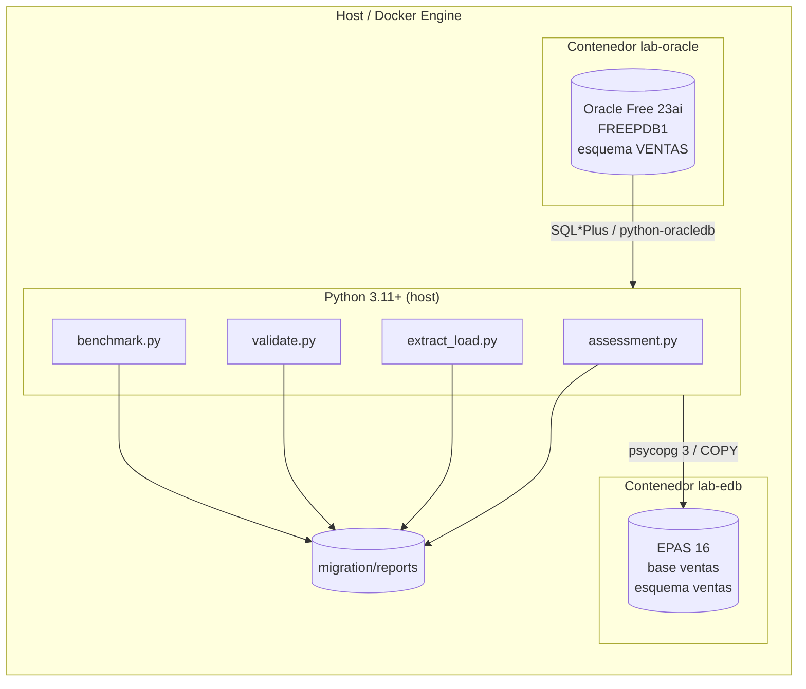
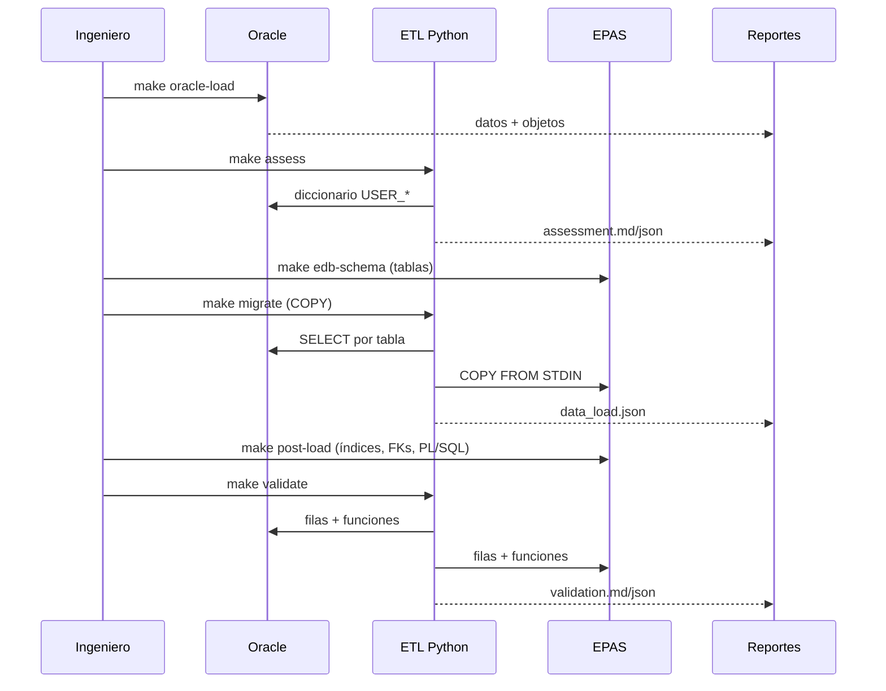

# 01. Arquitectura del laboratorio

## Vista general



## Componentes

| Componente | Imagen / tecnología | Puerto | Rol |
|---|---|---|---|
| `oracle` | `gvenzl/oracle-free:23-slim` | 1521 | Origen; PDB `FREEPDB1`, usuario `ventas` |
| `edb` | Imagen oficial EPAS + entrypoint propio | 5444 | Destino; base `ventas`, esquema `ventas` |
| ETL | Python 3.11+, `oracledb` thin, `psycopg` 3 | — | Assessment, carga y validación |
| Reportes | JSON + Markdown | — | Evidencia de la migración |
| Herramientas EDB | Portal, MTK, LiveCompare, EDB*Loader | — | Evaluación, conversión y validación opcionales |
| CI | GitHub Actions | — | Lint, compilación y pruebas unitarias |

## Flujo por fases



## Fases y responsables

| Fase | Comando | Salida | Criterio de aceptación |
|---|---|---|---|
| 1. Infraestructura | `make up` | Contenedores healthy | Oracle y EPAS responden |
| 2. Origen | `make oracle-load` | Esquema y datos | 12 tablas con datos |
| 3. Assessment | `make assess` | `assessment.md` | Riesgos identificados |
| 4. Esquema destino | `make edb-schema` | Tablas/columnas | DDL compila |
| 5. Datos | `make migrate` | `data_load.json` | Sin errores de COPY |
| 6. Post-carga | `make post-load` | Índices/FKs/PL/SQL | Objetos compilan |
| 7. Validación | `make validate` | `validation.md` | 100 % OK |
| 8. Performance | `make benchmark` | `benchmark.md` | Sin regresiones graves |

## Decisiones de arquitectura

### ¿Por qué dos motores en contenedores separados?

Aísla dependencias, permite reiniciar uno sin el otro y reproduce un escenario
real de migración. El ETL habla con ambos por red/publicación de puertos.

### ¿Por qué un ETL propio si existe Ora2Pg?

Ora2Pg es excelente para DDL y volúmenes grandes, pero el objetivo didáctico
es controlar cada conversión: `CLOB`, `BLOB`, `RAW`, `XMLTYPE`, JSON, arrays,
zonas horarias y secuencias. El ETL propio hace explícito lo que una
herramienta automática suele ocultar. Ora2Pg se documenta como complemento.

### ¿Por qué crear índices y FKs después de la carga?

- `COPY` sin índices es más rápido.
- Las FKs se pueden añadir como `NOT VALID` y validar después, con un lock
  más corto.
- Los triggers se crean al final para que la carga no dispare auditoría ni
  historial duplicado.

### ¿Por qué paquetes en EPAS?

EPAS soporta `CREATE PACKAGE` y `CREATE PACKAGE BODY`. Conservar los paquetes
reduce el cambio en la aplicación y demuestra la compatibilidad Oracle. Las
partes no portables se aíslan y se documentan.

### ¿Por qué validar con checksums y no solo con conteos?

Dos tablas pueden tener el mismo número de filas y datos distintos. El hash
canónico por fila detecta diferencias de valor, incluyendo JSON, arrays,
timestamps y binarios.

## Puertos y red

| Servicio | Host | Contenedor | Credenciales |
|---|---|---|---|
| Oracle | `localhost:1521` | `1521` | `ventas` / `.env`; SYS/SYSTEM con `ORACLE_PASSWORD` |
| EPAS | `localhost:5444` | `5444` | `ventas` / `.env`; superusuario `enterprisedb` |
| Oracle EM Express | no publicado | — | — |
| SSH / otros | no aplica | — | — |

Los contenedores comparten la red por defecto de Compose y se resuelven por
nombre (`oracle`, `edb`). El ETL corre en el host y usa `localhost`.

## Estructura del repositorio

```text
.
├── docker/                 # Compose, Dockerfile EPAS, grants Oracle
├── sql/oracle/             # Esquema y datos de origen
├── sql/edb/                # Esquema y objetos destino
├── migration/
│   ├── config/             # Manifiesto, pruebas y benchmark
│   ├── etl/                # Python
│   ├── ora2pg/             # Configuración complementaria
│   └── reports/            # Salidas (ignoradas por Git)
├── scripts/                # Orquestación Bash
├── docs/                   # Esta documentación
├── tests/                  # Pruebas unitarias sin base de datos
└── Makefile
```

## Límites de la arquitectura

- No hay HA, réplica ni backup automatizado.
- El contenedor EPAS se inicializa con un entrypoint propio; no es un
  despliegue soportado para producción.
- El benchmark no es comparable entre hardware distinto.
- La validación asume que el conjunto de datos cabe en memoria; para
  volúmenes grandes hay que usar cursores y checksums por rangos.
- La aplicación no se migra; solo la base de datos y su lógica.

## Siguiente paso

[02-requisitos.md](02-requisitos.md) para preparar el entorno.
