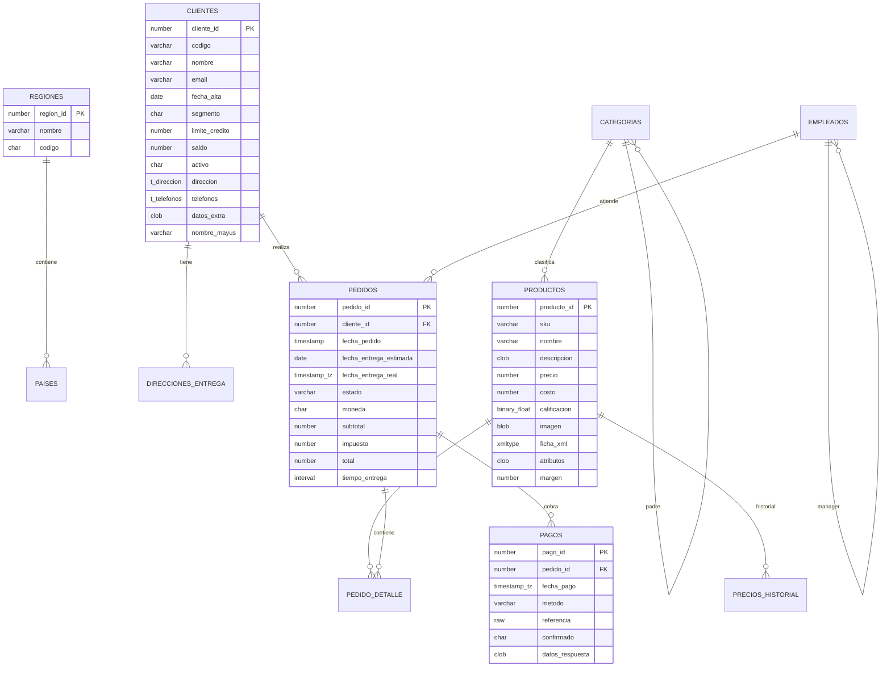

# 04. Modelo de datos

## Diagrama entidad-relación



## Tablas y propósito

| Tabla | Filas | Propósito | Construcciones Oracle destacadas |
|---|---:|---|---|
| `regiones` | 4 | Catálogo geográfico | `NUMBER`, `CHAR` |
| `paises` | 8 | Países por región | FK simple |
| `clientes` | 60 | Maestro de clientes | objeto, nested table, CLOB JSON, virtual, trigger |
| `direcciones_entrega` | 80 | Direcciones | FK `ON DELETE CASCADE`, unique compuesto |
| `categorias` | 12 | Árbol de categorías | auto-FK |
| `productos` | 40 | Catálogo | identidad, BLOB, XMLTYPE, CLOB JSON, `BINARY_FLOAT`, virtual |
| `empleados` | 15 | Jerarquía organizacional | auto-FK, `CONNECT BY` |
| `pedidos` | 300 | Cabecera de pedidos | `DATE`, `TIMESTAMP`, `TIMESTAMP WITH TIME ZONE`, `INTERVAL` |
| `pedido_detalle` | ~750 | Líneas | identidad, unique compuesto, trigger de total |
| `pagos` | ~240 | Pagos | `RAW(16)`, `TIMESTAMP WITH TIME ZONE`, CLOB JSON |
| `auditoria_cambios` | ~140 | Bitácora | identidad, CLOB, `TIMESTAMP WITH LOCAL TIME ZONE`, trigger autónomo |
| `precios_historial` | 8 | Historial de precios | trigger `AFTER UPDATE` |

Las filas exactas dependen de la semilla; el ETL y la validación las leen del
origen, no de valores hardcodeados.

## Objetos Oracle

### Tipos definidos por el usuario

```sql
CREATE OR REPLACE TYPE t_direccion AS OBJECT (
  calle VARCHAR2(150), ciudad VARCHAR2(80), estado VARCHAR2(80),
  pais CHAR(2), codigo_postal VARCHAR2(12)
);

CREATE OR REPLACE TYPE t_telefonos AS TABLE OF VARCHAR2(30);
```

- `clientes.direccion` es una columna de objeto.
- `clientes.telefonos` es una nested table almacenada en `NT_TELEFONOS`.

En EPAS se convierten en columnas planas `dir_*` y un arreglo `text[]`. Es una
decisión de diseño, no una conversión automática; se documenta en
[05-mapeo-tipos-datos.md](05-mapeo-tipos-datos.md).

### Secuencias e identidades

| Objeto | Patrón | Equivalente EPAS |
|---|---|---|
| `seq_clientes` | trigger `BEFORE INSERT` | `seq_clientes` + trigger con `nextval()` |
| `seq_direcciones` | trigger | `seq_direcciones` + trigger |
| `seq_pedidos` | trigger/paquete | `seq_pedidos` + trigger |
| `seq_pagos` | trigger | `seq_pagos` + trigger |
| `seq_historial` | trigger de precio | `seq_historial` + trigger |
| `productos.producto_id` | `GENERATED BY DEFAULT AS IDENTITY` | identidad |
| `pedido_detalle.detalle_id` | identidad | identidad |
| `auditoria_cambios.auditoria_id` | identidad | identidad |

Todas se resincronizan después de la carga porque el ETL inserta IDs
explícitos.

### Índices

20 índices en Oracle, entre ellos:

- B-tree simple y compuesto.
- Único funcional `UPPER(email)`.
- Bitmap `bix_pedidos_moneda`.
- Funcional con `CASE` para productos activos.
- Descendente `(cliente_id, fecha_pedido DESC)`.
- Índice sobre columna virtual `nombre_mayus`.
- Índices de soporte para FKs.

EPAS reproduce la mayoría; bitmap e IOT no existen y se documentan como
brechas.

### Vistas

| Vista | Tipo | Reto |
|---|---|---|
| `vw_clientes_activos` | simple con `CHECK OPTION` | acceso a atributos de objeto |
| `vw_resumen_pedidos` | agregada con joins | `NVL` vs `COALESCE` |
| `vw_ventas_mensuales` | agregada | `TRUNC(fecha,'MM')` vs `date_trunc` |
| `vw_jerarquia_empleados` | jerárquica | `CONNECT BY`; EPAS lo soporta |
| `vw_top_productos` | analítica | `RANK()` |
| `vw_ultimos_pedidos` | top N | `ROWNUM` vs `LIMIT` |

### Vista materializada

`mv_ventas_mensuales` se crea con `REFRESH COMPLETE ON DEMAND`. EPAS crea una
MV equivalente, pero sin refresco rápido ni `ON COMMIT`.

### Paquetes PL/SQL

| Paquete | Responsabilidad | Dificultad |
|---|---|---|
| `pkg_util` | formato, días hábiles, edad, log | baja |
| `pkg_auditoria` | registro autónomo en bitácora | media |
| `pkg_ventas` | pedidos, totales, descuentos, refcursor, MERGE | alta |
| `pkg_mantenimiento` | refresco de MV, estadísticas, conteo dinámico | media |

### Triggers

| Trigger | Evento | Propósito |
|---|---|---|
| `trg_clientes_bi` | BEFORE INSERT | asignar secuencia y defaults |
| `trg_clientes_aud` | AFTER I/U/D | auditoría con paquete autónomo |
| `trg_direcciones_bi` | BEFORE INSERT | asignar secuencia |
| `trg_productos_precio` | AFTER UPDATE | historial + auditoría |
| `trg_pedidos_bi` | BEFORE I/U | validar cliente, estado y total |
| `trg_pedido_detalle_biu` | BEFORE I/U | calcular `total_linea` |
| `trg_pagos_bi` | BEFORE INSERT | asignar secuencia y fecha |

## Decisiones de modelado

### Datos sintéticos deterministas

La semilla usa fórmulas (`MOD`, aritmética de fechas) para que los datos sean
reproducibles. Solo `SYSTIMESTAMP` y `SYS_GUID()` varían; el ETL los copia y
la validación los compara contra el valor real cargado, no contra una constante.

### Cliente inactivo

El cliente 60 está inactivo para probar:

- El filtro de `vw_clientes_activos` (59 filas).
- La validación de `trg_pedidos_bi`.
- Los errores de `pkg_ventas.crear_pedido`.

### Productos inactivos

Algunos productos están inactivos; los pedidos históricos pueden contenerlos,
pero `pkg_ventas.agregar_detalle` rechaza productos inactivos en pedidos nuevos.

### Totales calculados

`pkg_ventas.recalcular_totales` calcula subtotal, descuento por segmento,
impuesto (16 %) y total. Los pedidos sembrados pasan por el paquete, así que
los totales son consistentes con la lógica de negocio.

### Auditoría real

La bitácora no se inserta a mano: la generan los triggers durante la semilla.
El ETL la copia tal cual. Los triggers de EPAS se crean después de la carga
para no duplicar eventos.

## Cómo inspeccionar el modelo

```bash
make oracle-cli
```

```sql
SELECT table_name, num_rows FROM user_tables ORDER BY 1;
SELECT object_name, object_type, status FROM user_objects ORDER BY 2, 1;
SELECT index_name, index_type, table_name FROM user_indexes ORDER BY 2, 1;
SELECT * FROM vw_resumen_pedidos WHERE rownum <= 5;
```

```bash
docker compose --env-file .env -f docker/compose.yaml exec edb \
  edb-psql -U ventas -d ventas -c '\d+ ventas.pedidos'
```

## Siguiente paso

[05-mapeo-tipos-datos.md](05-mapeo-tipos-datos.md): la tabla de conversión y
los errores que hay que evitar.
