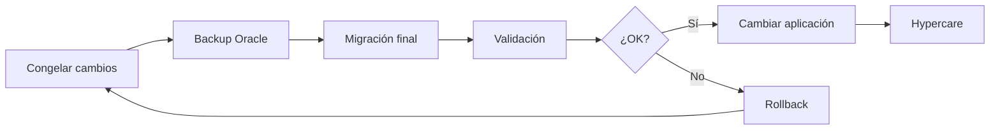

# 15. Post-migración y cutover

Migrar los datos es la mitad. El corte a producción exige planificar la
aplicación, el rendimiento, la seguridad, el respaldo y la vuelta atrás.

## Fases del cutover



### 1. Congelar cambios

- Cerrar escrituras o poner la aplicación en modo mantenimiento.
- Confirmar que no hay jobs ni ETL escribiendo en Oracle.
- Registrar el SCN o un punto de corte.
- Comunicar la ventana.

### 2. Backup

- Backup completo de Oracle (RMAN o snapshot).
- Snapshot del volumen de EPAS si ya tiene datos.
- Guardar scripts, configuración y reportes de la versión desplegada.

### 3. Migración final

```bash
make oracle-load       # solo si reconstruyes el origen; en producción no
make edb-schema
make migrate
make post-load
make validate
```

En un corte real no se recarga Oracle; se ejecuta el ETL contra el origen
congelado. El laboratorio usa `make oracle-load` porque es sintético.

### 4. Validación

- `make validate` OK.
- Conteos y checksums.
- Pruebas funcionales.
- UAT de los procesos críticos.
- Revisión de logs de aplicación.

### 5. Cambio de aplicación

- Actualizar cadenas de conexión.
- Driver: `psycopg`/JDBC PostgreSQL en lugar de `oracledb`/JDBC Oracle.
- Revisar SQL específico de Oracle.
- Revisar mayúsculas/minúsculas, fechas, secuencias y `RETURNING`.
- Prueba de humo.

### 6. Rollback

Debe ser posible volver a Oracle si la validación o la UAT fallan:

- Mantener Oracle en solo lectura hasta el go/no-go.
- No borrar el esquema Oracle.
- Tener el backup y el plan de reversión de la aplicación.
- Documentar el punto de no retorno.

### 7. Hypercare

- Primeras 24–72 horas con monitoreo intensivo.
- Revisar errores, latencia, locks, secuencias, MV y jobs.
- Tener un canal de soporte y un responsable.

## Cambios típicos en la aplicación

| Área | Oracle | EPAS |
|---|---|---|
| Conexión | `jdbc:oracle:thin:@host:1521/FREEPDB1` | `jdbc:postgresql://host:5444/ventas` |
| Driver | `ojdbc` | JDBC PostgreSQL / Npgsql / psycopg |
| Esquema | `VENTAS.CLIENTES` | `ventas.clientes` |
| Fecha | `DATE` con hora | `timestamp(0)` |
| Booleano | `CHAR(1)` o `NUMBER(1)` | `char(1)` o `boolean` |
| Secuencia | `seq.NEXTVAL` | `nextval('seq')` |
| Paginación | `ROWNUM` | `LIMIT/OFFSET` |
| Upsert | `MERGE` | `MERGE` o `ON CONFLICT` |
| Vacío/NULL | `''` = `NULL` | `''` ≠ `NULL` |
| Identificadores | Mayúsculas | Minúsculas |
| Transacciones | `COMMIT` explícito | `COMMIT` explícito; autocommit según driver |

### ORMs

- Hibernate/JPA: revisa dialecto, `@SequenceGenerator`, `GenerationType.IDENTITY`.
- Entity Framework: proveedor Npgsql; revisa tipos `numeric`, `timestamptz`.
- SQLAlchemy: dialecto `postgresql`; revisa `server_default`.
- MyBatis: SQL manual; revisa `ROWNUM`, `NVL`, `DECODE`.

## Seguridad

- Crea roles separados para aplicación, lectura y ETL.
- No uses `enterprisedb` para la aplicación.
- Otorga solo los privilegios necesarios.
- Revisa `search_path` y evita creación de objetos en `public`.
- Habilita TLS si la red no es confiable.
- Rota contraseñas y usa un gestor de secretos.
- Audita accesos y cambios.
- Revisa Row Level Security si usas `DBMS_RLS` en Oracle.
- Cifra backups y datos sensibles.

Ejemplo de roles:

```sql
CREATE ROLE app_ventas LOGIN PASSWORD '...';
GRANT CONNECT ON DATABASE ventas TO app_ventas;
GRANT USAGE ON SCHEMA ventas TO app_ventas;
GRANT SELECT, INSERT, UPDATE, DELETE ON ALL TABLES IN SCHEMA ventas TO app_ventas;
GRANT USAGE, SELECT ON ALL SEQUENCES IN SCHEMA ventas TO app_ventas;
```

En producción, usa `ALTER DEFAULT PRIVILEGES` y revisa los permisos de
funciones/paquetes.

## Respaldo y recuperación

Opciones:

- `pg_dump`/`pg_restore` para bases pequeñas.
- Barman para backups físicos y PITR.
- Snapshots de volumen.
- Réplica en streaming para HA.
- EDB Backup and Recovery Tool / EFM para entornos EDB.

Antes del corte:

- Probar una restauración completa.
- Medir RTO/RPO.
- Documentar el procedimiento.
- Verificar que los backups incluyen el esquema `ventas` y los roles.

## Alta disponibilidad

Para producción:

- Réplica streaming síncrona/asíncrona.
- Failover gestionado (EFM, Patroni, CloudNativePG).
- Load balancer / service discovery.
- Pruebas de failover.
- Monitoreo de lag.

El laboratorio es un solo nodo; no cubre HA.

## Monitoreo

Métricas clave:

- Conexiones activas vs `max_connections`.
- Locks y esperas.
- `pg_stat_activity` por estado.
- Cache hit ratio.
- Transacciones por segundo.
- Consultas lentas (`pg_stat_statements`).
- Crecimiento de tablas/índices.
- Replicación (si aplica).
- Jobs y refresco de MV.
- Errores de aplicación.

Herramientas: PEM, Prometheus + postgres_exporter, Grafana, pgBadger,
`pg_stat_*`.

## Mantenimiento

- `VACUUM`/autovacuum: no lo desactives.
- `ANALYZE` después de cargas grandes.
- Revisa bloat y `n_dead_tup`.
- Reindexa solo si es necesario (`REINDEX CONCURRENTLY`).
- Refresca MVs según SLA.
- Rota logs.
- Aplica parches de EPAS/PostgreSQL con ventana.
- Revisa extensiones y compatibilidad.

## Rendimiento post-corte

- Compara métricas de Oracle vs EPAS con la misma carga.
- Revisa las consultas top por tiempo total, no solo por media.
- Ajusta índices según planes reales.
- Revisa `work_mem`, `shared_buffers`, `effective_cache_size`.
- No copies parámetros de Oracle a PostgreSQL sin entenderlos.
- Mide el tiempo de la aplicación, no solo SQL.

## Checklist de cutover

### Go/No-Go

- [ ] Migración y validación OK.
- [ ] UAT firmada.
- [ ] Backups probados.
- [ ] Rollback documentado.
- [ ] Aplicación probada contra EPAS.
- [ ] Roles y permisos revisados.
- [ ] Monitoreo listo.
- [ ] Ventana y responsables confirmados.

### Durante

- [ ] Congelar escrituras.
- [ ] Backup.
- [ ] Migración final.
- [ ] Validación.
- [ ] Cambio de conexión.
- [ ] Smoke tests.
- [ ] Monitoreo intensivo.

### Después

- [ ] Jobs y MV funcionando.
- [ ] Sin errores en logs.
- [ ] Rendimiento aceptable.
- [ ] Secuencias sin colisiones.
- [ ] Backups del nuevo entorno.
- [ ] Documentación actualizada.
- [ ] Hypercare.

## Rollback

```text
1. Detener la aplicación.
2. Revertir la cadena de conexión a Oracle.
3. Reactivar escrituras en Oracle (si se congelaron).
4. Verificar integridad y jobs.
5. Comunicar.
6. Analizar la causa antes de reintentar.
```

No hagas rollback parcial de datos sin un plan: si la aplicación escribió en
EPAS, esas transacciones deben reconciliarse.

## Siguiente paso

[16-ora2pg.md](16-ora2pg.md) y [17-referencias.md](17-referencias.md).
